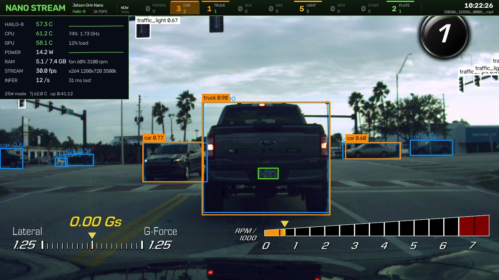
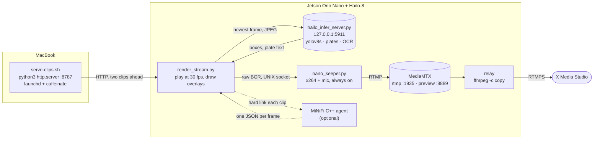
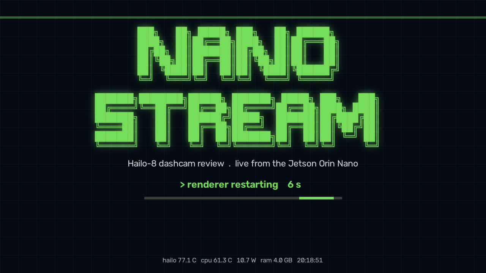

<div align="center">



# NanoStream

**Dashcam video played through a Jetson Orin Nano, a Hailo-8 boxing every frame, live on X.**

One box decodes the clips, runs the detector, draws the overlays, encodes the stream and relays it, with nothing in the cloud but the viewer.

[](https://github.com/steven-matison/NanoStream/actions/workflows/ci.yml)
[](LICENSE)


[](https://developer.nvidia.com/embedded/jetson-orin-nano-developer-kit)


[](https://hailo.ai/products/ai-accelerators/hailo-8-m2-ai-acceleration-module/)


[](https://github.com/cldr-steven-matison/MiNiFi-C-Object-Detection)
[](https://github.com/bluenviron/mediamtx)

</div>

---

My car's dashcam records to an SD card: hundreds of 10-minute clips with the speed, gear, G-force and RPM burned into the picture. I wanted those clips played back through a Jetson Orin Nano with a Hailo-8 in its M.2 slot, every car, truck, person, light and plate boxed on the frame, and the result on a live stream. NanoStream is that pipeline. A MacBook serves the clips over HTTP, the Jetson plays them at real-time pace, the Hailo-8 runs YOLOv8s on every frame it can, and the picture goes out as x264 720p30 to a local MediaMTX and from there to X.

A second engine can ride on the same picture. A MiNiFi C++ agent on the same Jetson scores the same clips on the CPU with its own object detection and scene classification, and NanoStream draws its results along the bottom of the frame in step with the playhead. The agent's flow and its models are in [MiNiFi-C-Object-Detection](https://github.com/cldr-steven-matison/MiNiFi-C-Object-Detection).

## Quick start

On the Mac that holds the clips:

```bash
git clone https://github.com/steven-matison/NanoStream && cd NanoStream
bash mac/install-launchd.sh "/Volumes/<drive>/<clips folder>"    # served on :8787, kept up by launchd
```

On the Jetson, with the Hailo-8 driver and HailoRT's Python wheel already in place ([The Hailo side](#the-hailo-side)):

```bash
git clone https://github.com/steven-matison/NanoStream && cd NanoStream
NANOSTREAM_VENV=~/my-hailo-venv ./install.sh       # the venv that holds hailort; omit to create ~/.nanostream/venv
nano-stream keeper                                  # the always-on encoder, publishing to the local MediaMTX
nano-stream start http://<mac-ip>:8787/             # the renderer, feeding the keeper
```

Open `http://<jetson-ip>:8889/nano/` for the browser preview. To go live on X, put the stream key from Media Studio (Producer, Sources) in `~/.x-stream.env` as `X_KEY=<key>`, then:

```bash
nano-stream relay                                   # copy the local stream to X, no re-encode
```

and press Go Live in Media Studio once the source shows as receiving. The X player runs 15 to 30 s behind the preview.

## The picture

Every frame carries three overlays, all drawn on the Jetson:

| Overlay | Where | What it shows |
|---|---|---|
| Detections | on the picture | the Hailo-8's boxes with filled label chips; plate boxes in green, with the text when a plate is big enough to read |
| The band | across the top | `NANO STREAM` and the hardware, then nine counters (PERSON, CAR, TRUCK, BUS, BIKE, LIGHT, SIGN, OTHER, PLATE): big, the boxes on screen now; small, the objects seen this run; the clock and the clip on the right |
| The health panel | top left, solid | Hailo die, CPU and GPU temperature with load and clock, board power from the INA3221 `VDD_IN` rail, RAM, fan duty and rpm, stream fps, inference rate, two-minute sparklines; temperatures turn amber and red as they heat |
| The MiNiFi bar | along the bottom | the C++ agent's images scored, seconds per image, CPU and RSS, its object counters for the frame at the playhead, the Places365 scene, and a timeline ticked at every frame it has scored |

The panel is solid on purpose: it sits over the dashcam's own speed readout and hides it.

<div align="center">

<br><sub>The MiNiFi bar: the agent's own result for the second on screen.</sub>
</div>

The detector has no object ids, so the band's totals come from a light tracker that follows each box from pass to pass (same class, IoU 0.2 or a centre within half the box's diagonal). A track counts once it has been seen on 3 passes and is dropped after 0.8 s unseen, so the total is an estimate of objects, not of boxes. PLATE's total is the distinct plate texts read.

## How it works



- **The renderer** (`render_stream.py`) downloads the next clip while the current one plays, decodes it with OpenCV, and keeps the encoder fed at the stream's frame rate. Inference runs on a side thread that always takes the newest frame, so a 1.5 s plate OCR pass never stalls the picture; the boxes trail by a frame or two. When there is nothing to play (a fetch still running, the server away), it shows a loading card with the download's progress instead of going silent.
- **The Hailo daemon** (`hailo_infer_server.py`) holds three Model Zoo networks open on one VDevice under the round-robin scheduler: `yolov8s` for 80 COCO classes with NMS on the chip, `tiny_yolov4_license_plates` on each vehicle crop, and `lprnet` as a digits-only cross-check. Plate text comes from RapidOCR on the CPU, because the Hailo LPRNet can only emit digits.
- **The keeper** (`nano_keeper.py`) owns the x264 encoder, the mic and the publish. The renderer hands it raw frames over a UNIX socket. When the frames stop, it holds the last one for 1.5 s and then shows the NANO STREAM card with a counter and the board's temperatures, so a renderer restart, a skipped clip or a crash never reaches the viewer.
- **MediaMTX** is the local RTMP server: the keeper publishes to it, the browser previews from it, and the relay copies it to X.
- **The relay** is a static ffmpeg doing `-c copy` to `rtmps://a.live.x.com:443/x/<key>`, at about 3 % of one core.

<div align="center">

<br><sub>The keeper's card. X never sees a gap, so it never shows its own offline screen.</sub>
</div>

## Run it

Start in this order. Each start sends its output to a log under `/tmp` and reads from `/dev/null`, so an SSH session that starts it can close.

```bash
systemctl --user status hailo-infer mediamtx       # both installed and started by install.sh
nano-stream health                                 # the daemon's models and the Hailo die temperature
KEEPER_ARGS="--audio plughw:2,0" nano-stream keeper    # with a USB mic; arecord -l lists the cards
nano-stream start http://<mac-ip>:8787/
nano-stream relay                                  # only for X
nano-stream status                                 # keeper, renderer, relay, the die
```

Stop in the reverse order:

```bash
nano-stream relay-stop
nano-stream stop                                   # the renderer only; the keeper stays on its card
nano-stream keeper-stop                            # takes the stream itself down
```

| Command | What it does |
|---|---|
| `nano-stream next` | skips the clip playing; the renderer restarts at the next one with the same options, and the keeper covers the gap |
| `nano-stream mic plughw:3,0` | swaps the keeper's mic in one step (`none` for the silent track); the stream gaps for the keeper's restart, and the command prints how long |
| `nano-stream keeper-restart` | restarts the keeper with the url and options it last ran with |
| `nano-stream agent-pin 4,5 15` | one-shot pin of the MiNiFi C++ agent, every thread, for when the renderer is not running. While a show is up the renderer owns the pin and puts this back within 2 s |

Every stop finds its processes by pid file and its process tree, never by name, so it can't hit an SSH shell whose command line mentions a script.

Renderer options go in `NANO_STREAM_ARGS` before `start`:

| Option | Default | What it does |
|---|---|---|
| `--start-at <name>` | | start at the first clip whose name sorts at or after this |
| `--skip N` | 0 | skip the first N clips |
| `--hours 9-15` | all | play only clips recorded in that hour range, read from a `YYMMDD_HHMMSS_` file name |
| `--loop` | off | start over at the end of the list |
| `--mask-hud pdr` | `pdr` | black out the burned-in telemetry before inference (the picture keeps it); `none` for clean footage |
| `--width 1920 --bitrate 6000k` | 1280, 3500k | 1080p; give the keeper the same with `KEEPER_ARGS="--width 1920 --height 1080 --bitrate 6000k"` |
| `--fps F`, `--preset P` | 30, `veryfast` | the stream's frame rate and x264 preset; give the keeper the same in `KEEPER_ARGS` |
| `--min-score S` | 0.4 | the lowest box score asked of the daemon, on `/detect` and `/plates` |
| `--plates-every N` | 10, or 30 with the bar | the plate pass on every Nth inference pass; the rest are detection only |
| `--records <file>` | | also append one JSON record per plate pass to this file |
| `--no-minifi` | bar on | no MiNiFi bar and no clips handed to the agent |
| `--lookahead N` | 2 | clips downloaded ahead of the one playing, one at a time, and handed to the agent as each download finishes |
| `--fetch-retries N` | 4 | tries at a clip's download before it is skipped; a 404 skips it at once |
| `--minifi-fps F` | 0.25 | the agent flow's Frames Per Second. The sync hold counts the frames a clip should have by it, so keep it equal to the flow's ([The MiNiFi bar](#the-minifi-bar)) |
| `--minifi-cores 4,5` | 4,5 | cores the agent is held to while a clip plays. It gets every core while the picture waits on its scores. `none` leaves it alone. Re-applied every 2 s |
| `--minifi-nice N` | 15 | lowest priority the agent's threads run at. The renderer only raises it |
| `--minifi-sync S`, `--minifi-wait T` | 0.9, 900 | hold a clip until the agent has scored S of it, for T seconds at most; `--minifi-sync 0` never waits |
| `--minifi-clips`, `--minifi-meta`, `--minifi-out` | `/tmp/minifi-detect/` `clips`, `meta`, `out` | the agent's three folders, for a flow built with another work folder |
| `--out-keep-min M` | 20 | minutes an annotated JPEG the agent wrote during this run is kept; 0 keeps all |
| `--tune none` | `zerolatency` | x264 with B-frames and lookahead back, for a better picture at the same bitrate with a little more encoder delay and CPU; give the keeper the same in `KEEPER_ARGS` |
| `--stall S` | 8 | seconds the encoder may refuse frames before it is replaced |
| `--intro S` | 3 | seconds of the NANO STREAM card before the first clip |
| `--cache-keep-h H` | 24 | on start, drop cached clips older than H hours and every half-written `.part` |
| `--audio plughw:N,0` | silent | a mic on the renderer's own encoder, when it runs without a keeper |

`nano-stream start` sets `--source`, `--url`, `--log` and `--daemon` itself, and `--cache` follows `NANOSTREAM_CACHE` ([Configuration](#configuration)).

## The MiNiFi bar

The bar needs a MiNiFi C++ 2.26.09 agent on the same Jetson running the flow from [MiNiFi-C-Object-Detection](https://github.com/cldr-steven-matison/MiNiFi-C-Object-Detection) at `--fps 0.25`. The two meet at three folders under `/tmp/minifi-detect/`:

| Folder | Who writes | What happens |
|---|---|---|
| `clips/` | NanoStream | each downloaded clip is hard-linked in (no copy), the agent's ListFile picks it up, and the link is released when the clip has played |
| `meta/` | the agent | one JSON per sampled frame with `video.clip`, `video.t_s`, `detections` (COCO class ids) and `scene` (Places365 top 3); the bar matches them to the clip and second on screen |
| `out/` | the agent | the agent's annotated JPEGs; NanoStream prunes the ones written during its run after 20 min |

The renderer keeps two clips ahead of the one playing (`--lookahead 2`). Downloads run one at a time, and each clip is handed to the agent as soon as its download finishes, so the agent is scoring the next clips while one plays. At 0.25 fps a 10-minute clip is 150 frames, and the agent scores about 1.8 s per frame beside the stream.

Before every clip plays, the renderer checks that the agent has scored 90 % of it (`--minifi-sync 0.9`). If not, it holds on the card ("MiNiFi is scoring the next clip", with a frame count) until it has, or for `--minifi-wait` seconds at most (900). With two clips ahead that hold is usually over before the clip is reached. A short clip in front of a long one can still trip it. When the agent is down there is no wait. Any MiNiFi C++ process on the box counts as the agent, so with an agent running some other flow pass `--no-minifi`, or every clip waits out `--minifi-wait` on the card. A restarted agent first finishes the frames it had queued when it stopped, from whatever clips those were, and the card shows which clip it is on. Drain that backlog before a show, or the first clip waits for it. The bar's state chip reads `IN SYNC`, `BEHIND <n>s`, `AHEAD <n>s`, `PREV CLIP` or `NEXT CLIP`, `QUEUED`, or `AGENT DOWN`.

The hold counts the frames a clip should have at `--minifi-fps` (0.25), so that has to match the flow's Frames Per Second. The flow repo's `conf/config.yml` is its bench default, 1 fps. `python3 flow/build_flow.py --fps 0.25` rewrites it at 0.25; on an EFM class, `python3 flow/efm_flow.py set extract-frames "Frames Per Second=0.25"` and publish. A flow faster than `--minifi-fps` clears the hold early (a 1 fps flow clears it with under a quarter of the clip's frames scored), and the bar then trails the picture. A slower one never reaches the count, so every clip waits out `--minifi-wait`.

The links are tracked in `clips/.nanostream-links`. A link left by a run that was killed is either adopted (its cache copy is still there) or removed on the next start (it was the clip's last copy). A clip put in `clips/` by hand is never touched.

Six cores do not hold the stream, the agent and a desktop browser at once. Keep Chromium closed on the Jetson during a show. While the renderer is running it places the agent itself: every core while the picture waits on its scores, cores 4 and 5 at nice 15 while a clip plays (`--minifi-cores`, `--minifi-nice`), and it re-applies that every 2 s. `nano-stream agent-pin` is the same pin for when the renderer is not running. Run it during a show and the renderer puts its own placement back within 2 s.

## The Mac source

`mac/serve-clips.sh <folder> [port]` is `python3 -m http.server` on the folder, bound to every interface. `mac/install-launchd.sh` runs it as a per-user LaunchAgent: it starts at login, waits for the drive if it is not mounted yet, restarts the server if it dies, and holds the Mac awake with `caffeinate -i` while it serves.

```bash
bash mac/install-launchd.sh "/Volumes/<drive>/<clips folder>" 8787
bash mac/install-launchd.sh --status
bash mac/install-launchd.sh --uninstall
```

The log is `~/Library/Logs/nanostream-clips.log`. On the first start macOS may ask to let `bash` and `python3` read the external drive; allow it, or the server lists an empty folder.

The Mac is in the loop because the dashcam drive is HFS+, and L4T ships no `hfsplus` module. A FAT, exFAT or NTFS drive plugged into the Jetson works too: `nano-stream start /media/$USER/<label>`. With the MiNiFi bar on, each clip from a mount is copied into the agent's folder in the background, since a hard link cannot cross filesystems.

## The Hailo side

NanoStream doesn't install the Hailo stack. It needs three things already on the Jetson:

- the `hailo_pci` driver with `/dev/hailo0` up, from [hailort-drivers](https://github.com/hailo-ai/hailort-drivers);
- HailoRT 4.24 and its Python wheel (`hailo_platform`), from [hailort](https://github.com/hailo-ai/hailort), installed into the venv NanoStream uses;
- the three HEFs, which `install.sh` downloads from the public [Hailo Model Zoo](https://github.com/hailo-ai/hailo_model_zoo) v2.20.0 Hailo-8 builds into `~/hailo/models`.

`./install.sh --check` reports each piece and changes nothing. [NanoTax](https://github.com/steven-matison/NanoTax) is a good first test that the module is alive and cooled.

The daemon's contract, for anything else that wants to call it:

```text
GET  /health        {"ok", "models", "chip_temp_c", "uptime_s", "counters"}
POST /detect        JPEG body → {"detections": [{"label", "score", "box": [x0, y0, x1, y1]}], "inference_ms"}
POST /plates        JPEG body → detections, plus "vehicles" each with "plates":
                    [{"box", "score", "width_px", "readable", "text", "text_conf", "text_candidates", "lprnet_digits"}]
                    ?min_score=0.35  &crops=1 (base64 crops)  &full=1 (plates outside vehicles too)
```

## Configuration

| Variable | Default | What it does |
|---|---|---|
| `NANOSTREAM_VENV` | the one the last install recorded, else `~/.nanostream/venv` | the venv `install.sh` uses or creates; a re-run or `--check` follows `~/.nanostream/env` |
| `NANOSTREAM_PY` | the venv `install.sh` used | the python `nano-stream` runs the app with; `install.sh` records it in `~/.nanostream/env` |
| `NANOSTREAM_RUN` | `/tmp` | pid files, logs and the keeper's socket |
| `NANOSTREAM_CACHE` | `/tmp/nano-stream-cache` | where clips are downloaded before they play |
| `HAILO_MODELS` | `~/hailo/models` | the HEFs |
| `HAILO_INFER_URL` | `http://127.0.0.1:5911` | the daemon, as the renderer and keeper see it |
| `HAILO_INFER_MIN_PLATE_PX` | `40` | plates narrower than this are reported `readable: false`, with no OCR. The daemon runs under systemd, so this and `HAILO_INFER_OCR_SURE` go in `~/.nanostream/hailo-infer.env`, then `systemctl --user restart hailo-infer` |
| `X_STREAM_ENV` | `~/.x-stream.env` | the file holding the X key; never printed, `status` redacts it |
| `X_INGEST` | `rtmps://a.live.x.com:443/x` | X's RTMPS ingest |
| `MEDIAMTX_DIR`, `MEDIAMTX_VERSION` | `~/mediamtx`, `v1.20.1` | where `install.sh` puts MediaMTX |

## Measured on the reference box

Jetson Orin Nano Developer Kit Super at 25 W, JetPack 7.2.1, a Hailo-8 M.2 module, HailoRT 4.24.0, 720p dashcam clips at 30 fps.

| Inference | |
|---|---|
| `/detect`, yolov8s at 640 on the chip | 21 to 28 ms |
| `/plates` round trip, no readable plate | p50 104 to 120 ms |
| a full OCR pass on a plate crop | +0.3 to 1.5 s, CPU |
| Hailo die, case closed | 66 °C at 2 frames/s, 74 to 80 °C under the stream |

| The stream | |
|---|---|
| x264 `veryfast` 720p30, encode alone | 107 fps, 3.6× play speed (1080p30: 1.8×) |
| renderer with inference on its thread | 30 fps at 1.0× play speed, about 25 inference passes/s |
| whole pipeline | load 5.9 on 6 cores, 3.8 of 7.3 GB RAM |
| relay to X | 3.5 Mbit/s, 1.0×, 2.7 % CPU |
| the band, the bar | 0.06 ms and 0.18 ms per frame |
| with the MiNiFi agent pinned to two cores | no card gaps, the agent at 1.8 s per frame |

A walk of one 9.6-minute clip at 1 frame/s with the telemetry masked found 1,214 cars, 178 trucks, 29 buses, 492 traffic lights, 10 stop signs, 28 people and 46 plates. None of the plates read. At 720p a plate at following distance is about 55 to 62 px wide, and nothing under about 100 px reads with any upscale, contrast or sharpening pass. On this kind of footage NanoStream is detection-first: plate boxes on every vehicle, and text only when a plate fills the frame (stopped right behind a car in daylight). A 4K dashcam moves that line.

## What it handles for you

- **The Orin Nano has no hardware video encoder.** NVIDIA's ffmpeg lists `h264_nvenc`, which fails with `Operation not permitted`, and it carries neither `libx264` nor `rtmp`. NanoStream uses the static ffmpeg from `imageio-ffmpeg`, which has both, and x264 `veryfast` holds 720p30 on the CPU.
- **That static ffmpeg can't resolve hostnames on L4T** (`Failed to resolve hostname ...: System error`, while `curl` resolves the same name). The relay resolves the ingest host with `getent`, hands ffmpeg the IP, and keeps the hostname for TLS (`-verifyhost`) and the RTMP `tcUrl`.
- **X's ingest is `a.live.x.com`.** The older `va.pscp.tv` still accepts a publish and takes the bytes, and Media Studio never shows the source as receiving.
- **`-rw_timeout` on the encoder's RTMP output kills the stream.** With it, this ffmpeg's writer stalls after about 40 s while x264 spins. The encoder is fed through a bounded queue instead; if it takes nothing for 8 s it is replaced.
- **MediaMTX drops a publisher that is silent for 10 s,** and X drops a source after about 10 s. The renderer prefetches the next clip and holds the last frame through any gap; the keeper covers everything else.
- **`python3 -m http.server` serves no byte ranges,** and an MP4's index can sit at its end, so each clip is downloaded whole before it opens. Only one download runs at a time: two on one link halved each other.
- **Burned-in telemetry fools the detector.** Left in, the OCR reads `LATERAL` and `000 GS` as plates and the detector counts the G-force marker as a kite. `--mask-hud pdr` blacks those zones out of what inference sees.
- **The bare Hailo-8 module runs hot** and throttles past 90 °C; the panel shows the die so a slowdown is easy to place.
- **`renice -p <pid>` reaches one thread on Linux.** `agent-pin` renices every task of the agent and pins all of them with `taskset -a`.
- **A static ffmpeg opens some USB mics only through ALSA's plug layer.** Use `plughw:N,0`, not `hw:N,0`. The dev kit's USB-C port is device mode; plug the mic into a Type-A port.

## The batch walker

`nanostream/dashcam_walker.py` walks a file, a folder or an HTTP listing at N frames/s through the daemon's `/plates`, and writes one JSON record per frame, plate crops and annotated keyframes. It is the tool for a full pass over a drive and for checking what the plate reader can do on new footage:

```bash
. ~/.nanostream/env && $NANOSTREAM_PY nanostream/dashcam_walker.py --source http://<mac-ip>:8787/ \
    --fps 1 --mask-hud pdr --out ~/dashcam-runs/run1 --crops
```

`--resume` skips every clip that already has a record (a clip cut short is not finished), and `--skip N` and `--start-at <name>` pick the place; `--max-temp 88` pauses at that die temperature until it is 5 °C under; `--post <url>` sends every record to an HTTP endpoint as well.

## License

[Apache License 2.0](LICENSE). The HEFs come from the Hailo Model Zoo and the OCR models ship inside the `rapidocr-onnxruntime` wheel, each under its own license.
